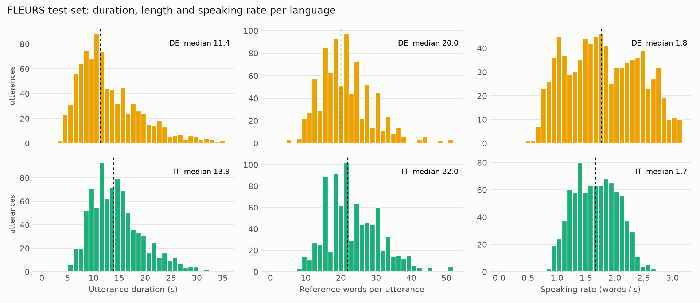

# Data exploration

Generated by `src/explore_data.py`. Do not edit by hand.

## Overview per language and split

| language   | split   |   utterances |   unique_sentences |   hours |   words |   dur_mean |   dur_median |   dur_p05 |   dur_p95 |   dur_max |   words_mean |   words_per_sec |   over_30s |   recordings_per_sentence |
|:-----------|:--------|-------------:|-------------------:|--------:|--------:|-----------:|-------------:|----------:|----------:|----------:|-------------:|----------------:|-----------:|--------------------------:|
| de         | train   |         2987 |               1462 |    9.00 |   61696 |      10.85 |        10.44 |      6.36 |     16.74 |     26.76 |        20.65 |            1.90 |          0 |                      2.04 |
| de         | dev     |          363 |                147 |    1.26 |    7342 |      12.53 |        10.98 |      5.28 |     23.63 |     38.82 |        20.23 |            1.75 |          4 |                      2.47 |
| de         | test    |          862 |                347 |    3.15 |   18507 |      13.17 |        11.40 |      5.70 |     25.92 |     47.94 |        21.47 |            1.77 |         21 |                      2.48 |
| it         | train   |         3030 |               1485 |    9.00 |   68815 |      10.69 |        10.32 |      5.67 |     16.80 |     34.20 |        22.71 |            2.13 |          1 |                      2.04 |
| it         | dev     |          391 |                147 |    1.55 |    8722 |      14.24 |        13.56 |      7.35 |     24.06 |     39.96 |        22.31 |            1.59 |          6 |                      2.66 |
| it         | test    |          865 |                346 |    3.52 |   20605 |      14.65 |        13.92 |      7.99 |     24.82 |     52.92 |        23.82 |            1.67 |          8 |                      2.50 |

## Speaker gender

| language   | split   |   female |   male |
|:-----------|:--------|---------:|-------:|
| de         | dev     |        0 |    363 |
| de         | test    |        0 |    862 |
| de         | train   |     2549 |    438 |
| it         | dev     |      382 |      9 |
| it         | test    |      827 |     38 |
| it         | train   |     1313 |   1717 |

## Sentence overlap between splits

| language   | splits       |   shared_sentences |
|:-----------|:-------------|-------------------:|
| de         | train ∩ dev  |                  0 |
| de         | train ∩ test |                  0 |
| de         | dev ∩ test   |                  0 |
| it         | train ∩ dev  |                  0 |
| it         | train ∩ test |                  0 |
| it         | dev ∩ test   |                  0 |

## Parallel sentences across languages (test)

| languages   |   sentences |
|:------------|------------:|
| de          |         347 |
| it          |         346 |
| de ∩ it     |         343 |

## Normalisation-sensitive content, % of test utterances

Computed on the raw (cased, punctuated) reference.

| language   |   has_digit |   has_symbol |   has_hyphen_or_apostrophe |   has_abbreviation |   has_quote_or_bracket |   has_foreign_script |
|:-----------|------------:|-------------:|---------------------------:|-------------------:|-----------------------:|---------------------:|
| de         |        19.0 |          0.5 |                       14.4 |                7.3 |                   16.9 |                  0.0 |
| it         |        18.7 |          1.5 |                       45.3 |                6.2 |                   17.3 |                  0.0 |

## Utterances vs. time (test, one recording per sentence, seed 42)

| language   | budget                         |   utterances |   minutes |   ref_words |
|:-----------|:-------------------------------|-------------:|----------:|------------:|
| de         | 500 utterances (or all unique) |          347 |      77.0 |        7550 |
| it         | 500 utterances (or all unique) |          346 |      87.1 |        8468 |
| de         | 77 min of audio                |          347 |      77.0 |        7550 |
| it         | 77 min of audio                |          307 |      76.6 |        7468 |

## Audio health

Quiet = RMS below -50 dBFS (low recording gain, speech still present). No speech = under 10 dB between loud and quiet frames. Clipped = peak at full scale. Per-file values are in `audio_health.csv`.

| language   | split   |   files |   sample_rates |   channels |   duration_mismatch |   quiet |   no_speech |   clipped |   rms_db_median |   peak_median |
|:-----------|:--------|--------:|---------------:|-----------:|--------------------:|--------:|------------:|----------:|----------------:|--------------:|
| de         | dev     |     363 |          16000 |          1 |                   0 |       0 |           0 |         0 |         -29.712 |         0.235 |
| de         | test    |     862 |          16000 |          1 |                   0 |       0 |           0 |         0 |         -29.718 |         0.246 |
| it         | dev     |     391 |          16000 |          1 |                   0 |       0 |           0 |         0 |         -26.219 |         0.361 |
| it         | test    |     865 |          16000 |          1 |                   0 |       0 |           0 |         0 |         -26.803 |         0.356 |

## Distributions

