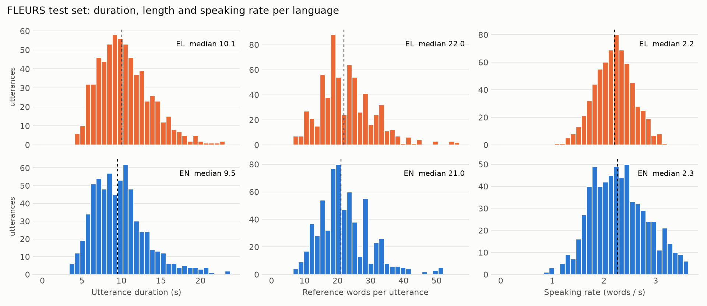

# Data exploration

Generated by `src/explore_data.py`. Do not edit by hand.

## Overview per language and split

| language   | split   |   utterances |   unique_sentences |   hours |   words |   dur_mean |   dur_median |   dur_p05 |   dur_p95 |   dur_max |   words_mean |   words_per_sec |   over_30s |   recordings_per_sentence |
|:-----------|:--------|-------------:|-------------------:|--------:|--------:|-----------:|-------------:|----------:|----------:|----------:|-------------:|----------------:|-----------:|--------------------------:|
| el         | train   |         3215 |               1496 |   10.04 |   73160 |      11.25 |        10.86 |      6.06 |     17.76 |     35.04 |        22.76 |            2.01 |          2 |                      2.15 |
| el         | dev     |          271 |                140 |    0.77 |    6028 |      10.19 |         9.84 |      5.46 |     15.90 |     24.60 |        22.24 |            2.15 |          0 |                      1.94 |
| el         | test    |          650 |                333 |    1.91 |   15106 |      10.56 |        10.08 |      5.76 |     16.83 |     32.40 |        23.24 |            2.21 |          1 |                      1.95 |
| en         | train   |         2602 |               1476 |    7.49 |   54782 |      10.36 |         9.78 |      5.76 |     17.16 |     42.36 |        21.05 |            2.12 |          6 |                      1.76 |
| en         | dev     |          394 |                150 |    1.05 |    8149 |       9.56 |         9.03 |      4.92 |     15.40 |     31.74 |        20.68 |            2.22 |          1 |                      2.63 |
| en         | test    |          647 |                350 |    1.77 |   14344 |       9.87 |         9.48 |      5.18 |     16.48 |     29.30 |        22.17 |            2.26 |          0 |                      1.85 |

## Speaker gender

| language   | split   |   female |   male |
|:-----------|:--------|---------:|-------:|
| el         | dev     |      125 |    146 |
| el         | test    |      325 |    325 |
| el         | train   |     1927 |   1288 |
| en         | dev     |      245 |    149 |
| en         | test    |      412 |    235 |
| en         | train   |     1570 |   1032 |

## Sentence overlap between splits

| language   | splits       |   shared_sentences |
|:-----------|:-------------|-------------------:|
| el         | train ∩ dev  |                  0 |
| el         | train ∩ test |                  0 |
| el         | dev ∩ test   |                  0 |
| en         | train ∩ dev  |                  0 |
| en         | train ∩ test |                  0 |
| en         | dev ∩ test   |                  0 |

## Parallel sentences across languages (test)

| languages   |   sentences |
|:------------|------------:|
| el          |         333 |
| en          |         350 |
| el ∩ en     |         333 |

## Normalisation-sensitive content, % of test utterances

Computed on the raw (cased, punctuated) reference.

| language   |   has_digit |   has_symbol |   has_hyphen_or_apostrophe |   has_abbreviation |   has_quote_or_bracket |   has_foreign_script |
|:-----------|------------:|-------------:|---------------------------:|-------------------:|-----------------------:|---------------------:|
| el         |        20.0 |          1.2 |                        3.5 |                3.4 |                   15.1 |                  9.2 |
| en         |        18.9 |          0.8 |                       23.3 |                8.7 |                   16.5 |                  0.0 |

## Utterances vs. time (test, one recording per sentence, seed 42)

| language   | budget                         |   utterances |   minutes |   ref_words |
|:-----------|:-------------------------------|-------------:|----------:|------------:|
| el         | 500 utterances (or all unique) |          333 |      60.5 |        7938 |
| en         | 500 utterances (or all unique) |          350 |      58.1 |        7788 |
| el         | 58 min of audio                |          321 |      57.8 |        7574 |
| en         | 58 min of audio                |          350 |      58.1 |        7788 |

## Audio health

Quiet = RMS below -50 dBFS (low recording gain, speech still present). No speech = under 10 dB between loud and quiet frames. Clipped = peak at full scale. Per-file values are in `audio_health.csv`.

| language   | split   |   files |   sample_rates |   channels |   duration_mismatch |   quiet |   no_speech |   clipped |   rms_db_median |   peak_median |
|:-----------|:--------|--------:|---------------:|-----------:|--------------------:|--------:|------------:|----------:|----------------:|--------------:|
| el         | dev     |     271 |          16000 |          1 |                   0 |       0 |           0 |         1 |         -31.967 |         0.221 |
| el         | test    |     650 |          16000 |          1 |                   0 |       0 |           0 |         0 |         -35.580 |         0.143 |
| en         | dev     |     394 |          16000 |          1 |                   0 |     265 |           0 |         0 |         -59.424 |         0.011 |
| en         | test    |     647 |          16000 |          1 |                   0 |     451 |           0 |         0 |         -59.983 |         0.009 |

## Distributions

