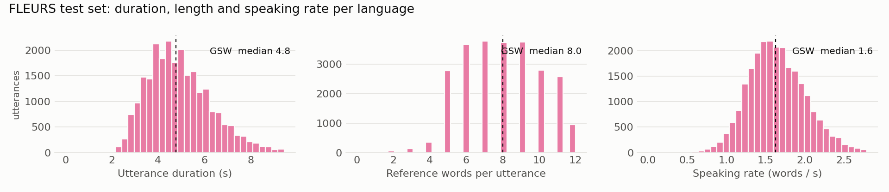

# Data exploration

Generated by `src/explore_data.py`. Do not edit by hand.

## Overview per language and split

| language   | split   |   utterances |   unique_sentences |   hours |   words |   dur_mean |   dur_median |   dur_p05 |   dur_p95 |   dur_max |   words_mean |   words_per_sec |   over_30s |   recordings_per_sentence |
|:-----------|:--------|-------------:|-------------------:|--------:|--------:|-----------:|-------------:|----------:|----------:|----------:|-------------:|----------------:|-----------:|--------------------------:|
| gsw        | test    |        24605 |               3515 |   33.84 |  195769 |       4.95 |         4.77 |      3.04 |      7.54 |     14.56 |         7.96 |            1.62 |          0 |                      7.00 |
| gsw        | dev     |        23217 |              23200 |   33.55 |  196797 |       5.20 |         4.92 |      3.07 |      8.28 |     15.36 |         8.48 |            1.67 |          0 |                      1.00 |
| gsw        | train   |       173194 |             167478 |  238.71 | 1474176 |       4.96 |         4.69 |      3.07 |      7.62 |     15.42 |         8.51 |            1.75 |          0 |                      1.03 |

## Speaker gender

| language   | split   |   female |   male |
|:-----------|:--------|---------:|-------:|
| gsw        | dev     |    11056 |  12161 |
| gsw        | test    |    14211 |  10394 |
| gsw        | train   |    91423 |  81771 |

## Sentence overlap between splits

| language   | splits       |   shared_sentences |
|:-----------|:-------------|-------------------:|
| gsw        | train ∩ dev  |                810 |
| gsw        | train ∩ test |                  0 |
| gsw        | dev ∩ test   |                  0 |

## Parallel sentences across languages (test)

## Normalisation-sensitive content, % of test utterances

Computed on the raw (cased, punctuated) reference.

| language   |   has_digit |   has_symbol |   has_hyphen_or_apostrophe |   has_abbreviation |   has_quote_or_bracket |   has_foreign_script |
|:-----------|------------:|-------------:|---------------------------:|-------------------:|-----------------------:|---------------------:|
| gsw        |         9.7 |          0.3 |                        5.9 |                5.1 |                    0.1 |                  0.0 |

## Utterances vs. time (test, one recording per sentence, seed 42)

| language   | budget                         |   utterances |   minutes |   ref_words |
|:-----------|:-------------------------------|-------------:|----------:|------------:|
| gsw        | 500 utterances (or all unique) |          500 |      41.7 |        3965 |
| gsw        | 42 min of audio                |          499 |      41.7 |        3959 |

## Audio health

Quiet = RMS below -50 dBFS (low recording gain, speech still present). No speech = under 10 dB between loud and quiet frames. Clipped = peak at full scale. Per-file values are in `audio_health.csv`.

| language   | split   |   files |   sample_rates |   channels |   duration_mismatch |   quiet |   no_speech |   clipped |   rms_db_median |   peak_median |
|:-----------|:--------|--------:|---------------:|-----------:|--------------------:|--------:|------------:|----------:|----------------:|--------------:|
| gsw        | test    |    3515 |          16000 |          1 |                   0 |       2 |           0 |        16 |         -25.423 |         0.524 |
| gsw        | dev     |     300 |          16000 |          1 |                   0 |       0 |           0 |         4 |         -24.570 |         0.631 |
| gsw        | train   |    5000 |          16000 |          1 |                   0 |       6 |           2 |       117 |         -24.303 |         0.589 |

### Files without speech (exclude these before sampling)

| id                                |   rms_db |   dynamic_range_db |   file_duration |
|:----------------------------------|---------:|-------------------:|----------------:|
| stt4sg_gsw_train_fc5db745ead7b793 |    -60.3 |                6.5 |             6.7 |
| stt4sg_gsw_train_323f96c3537d6ea0 |    -60.4 |                5.5 |             5.3 |

## Distributions

